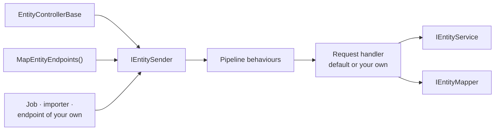

# Web Endpoints

Expose entity CRUD operations as HTTP endpoints, through controllers or as mapped minimal-API endpoints. Both serve the
same routes and send the same requests:

| Package | Description |
|---------|-------------|
| `Regira.Entities.Web` | MVC controllers via `EntityControllerBase`, or mapped endpoints via `MapEntityEndpoints()` ([Mapped Endpoints](#mapped-endpoints)) |
| `Regira.Entities.Mediator` | The requests both surfaces send through `IEntitySender` ([Entity Operations](#entity-operations)) |

---

## Controllers

Controllers provide a more traditional, attribute-based approach using `EntityControllerBase`. Use this when you need full customisation, a per-entity pipeline with DTO mapping, or advanced sorting and includes.

### Controller Selection

<!-- no-compile -->
```csharp
// basic (not recommended)
EntityControllerBase<TEntity>
EntityControllerBase<TEntity, TKey>
// basic (using DTOs, recommended)
EntityControllerBase<TEntity, TDto, TInputDto>
EntityControllerBase<TEntity, TSearchObject, TDto, TInputDto>
EntityControllerBase<TEntity, TKey, TSearchObject, TDto, TInputDto>
// complex (advanced operations)
EntityControllerBase<TEntity, TSearchObject, TSortBy, TIncludes, TDto, TInputDto>
EntityControllerBase<TEntity, TKey, TSearchObject, TSortBy, TIncludes, TDto, TInputDto>
```

### Route prefix

Best practice: 
Keep controller `[Route]` attributes **resource-relative**, and spell the resource as the kebab-case plural the mapped endpoints use (`[Route("products")]`, `[Route("intervention-types")]`). Avoid the `[controller]` token: it expands to the class-name stem, so an `InterventionTypesController` serves `/InterventionTypes`, which a client calling `intervention-types` does not reach. Apply a shared `api` base **once**, in a single configurable place:

- **At the host:** an IIS virtual directory / reverse-proxy path, or `app.UsePathBase("/api")`.
- **In the app:** a global route-prefix convention (the prefix can come from configuration):

<!-- no-compile -->
```csharp
using Microsoft.AspNetCore.Mvc;
using Microsoft.AspNetCore.Mvc.ApplicationModels;

public sealed class RoutePrefixConvention(string prefix) : IApplicationModelConvention
{
    private readonly AttributeRouteModel _prefix = new(new RouteAttribute(prefix));
    public void Apply(ApplicationModel application)
    {
        foreach (var controller in application.Controllers)
            foreach (var selector in controller.Selectors)
                selector.AttributeRouteModel = selector.AttributeRouteModel is { } existing
                    ? AttributeRouteModel.CombineAttributeRouteModel(_prefix, existing)
                    : _prefix;
    }
}

// Program.cs — register once; every controller is served under /api/...
builder.Services.AddControllers(options =>
    options.Conventions.Add(new RoutePrefixConvention("api")));
```

### Standard Endpoints

Simple and complex controller bases expose different endpoint sets. **Simple** bases (no `TSortBy`/`TIncludes`) expose Details, List (GET), `GET /search`, Save/Create/Modify/Patch/Delete. **Complex** bases additionally expose `POST /list` and `POST /search`.

#### Fetch Endpoints

**Details (all bases):**

<!-- no-compile -->
```csharp
// GET /{entities}/{id} - Single entity
Details(id) -> DetailsResult
```

**List (all bases):**

<!-- no-compile -->
```csharp
// GET /{entities} - Basic List
List() -> ListResult

// GET /{entities}?q={search}&page=1&pageSize=10 - List
List(searchObject, pagingInfo) -> ListResult

// Complex bases only — typed ?includes= and ?sortBy= bind on complex bases; simple bases ignore them
// GET /{entities}?categoryId=1&includes=Category&sortBy=CreatedDesc&sortBy=Title
List(searchObject, pagingInfo, includes[], sortBy[]) -> ListResult
```

**Search (all bases):**

<!-- no-compile -->
```csharp
// GET /{entities}/search?q={keyword}&page=1 - List + Count combined
// SearchResult carries a total Count alongside the items — use it to drive paging.
Search(searchObject, pagingInfo) -> SearchResult
```

**Complex POST endpoints — complex bases only:**

<!-- no-compile -->
```csharp
// POST /{entities}/list (collection of SearchObjects in body)
List([FromBody] searchObject[], pagingInfo, includes[], sortBy[]) -> ListResult

// POST /{entities}/search (collection of SearchObjects in body)
Search([FromBody] searchObject[], pagingInfo, includes[], sortBy[]) -> SearchResult
```

*The SearchObject items return queries that are inclusive (using Union).*

#### Paging

List and Search endpoints accept optional `page` and `pageSize` query parameters. `UseDefaults()` sets a default page size of **10** and a maximum of **100**, so a request without `pageSize` gets the first 10 rows; without either setting, it gets the full set. Configure the default and the maximum per app or per entity:

<!-- no-compile -->
```csharp
// Global — applies to every entity controller
services.UseEntities<AppDbContext>(options =>
{
    options.UseDefaults();
    // make sure to put this after UseDefaults()
    options.DefaultPageSize = 50;   // used when the request omits pageSize
    options.MaxPageSize = 200;      // any larger requested pageSize is clamped to this
    // or
    options.SetPageSize(pageSize: 50, maxPageSize: 200);
})
// Per-entity override — fully replaces the global values for that entity
.For<Product>(e => e.SetPageSize(defaultPageSize: 25, maxPageSize: 100))
// Opt out — this entity is never force-paged, even when a global default is set
.For<AuditLog>(e => e.SetPageSize());
```

- Both values are optional; `null` means that aspect is off.
- The default fills in when the request sends no `pageSize`; a `pageSize` of 0 or less takes `MaxPageSize`; an explicit larger `pageSize` is honoured unless `MaxPageSize` clamps it; `page` is preserved.
- **Enforced by the list and search requests, not the service** — the `ListQuery` and `SearchQuery` handlers apply the single shared clamp (`EntityListOptionsExtensions.ApplyPagingDefaults`), so the controllers, the mapped endpoints and any other sender of those requests page alike and `MaxPageSize` cannot be escaped through them. Calling `IEntityService.List(...)` directly (without `PagingInfo`) still returns the full set — the service layer keeps full control.

#### Save (Add/Modify/Patch)

<!-- no-compile -->
```csharp
// POST /{entities} - Create
Create(inputDto) -> SaveResult

// PUT /{entities}/{id} - Full update
Modify(id, inputDto) -> SaveResult

// PATCH /{entities}/{id} - Partial update (JSON Merge Patch, RFC 7386)
Patch(id) -> SaveResult   // body: the partial JSON document

// POST /{entities}/save - Upsert
Save(inputDto) -> SaveResult
```

> **PATCH behaviour:**
> - Accepts a JSON object containing only the fields to change; omitted fields are left untouched.
> - Setting a field to `null` clears it (RFC 7386 semantics).
> - The merge is one level deep: a nested object replaces the stored one whole, so a field it leaves out is cleared —
>   send the whole object.
> - The merge base is the current entity serialized to JSON and then deserialized as `TInputDto`, so only properties declared on the input model can be modified — audit/computed fields on `TEntity` are automatically excluded.
> - Related collections not included in the patch body are left intact while the merge base leaves them out. The entity is read with no includes flag, so a collection that `Includes()` loads only behind a flag (`includes?.HasFlag(…) == true`) reads `null`, "absent", not "remove all". This holds while the entity declares it without an initializer (`ICollection<OrderLine>? Lines { get; set; }`, no `= []`): an initialized one reads `[]`, and the save deletes its rows.
> - A collection that `Includes()` loads on every read is part of the merge base, so a PATCH saves it again through the child input DTO: a child column that DTO leaves out, and not `[ServerOwned]`, is cleared. Gate that include behind a flag, or keep every child column on the child input DTO or `[ServerOwned]`.
> - Assumes `TInputDto` property names match the corresponding `TEntity` property names.
> - The merged input is validated against `TInputDto`'s DataAnnotations before the save: a failure answers the **400**
>   of a validator's refusal, `errorDetails` included (below). The save then runs the validators as a `PUT` does.
> - A body that is no JSON object answers that 400 too, under the empty key — on a controller also a body that is not
>   JSON at all.

#### DELETE Endpoint

<!-- no-compile -->
```csharp
// DELETE /{entities}/{id} - Delete
Delete(id) -> DeleteResult
```

> **Refused writes:** a [validator](services.md#entity-validators) that rejects a write makes every write endpoint,
> `DELETE` included, answer **400** with a `ValidationProblemDetails` holding all the errors. In `errors` each message of
> a field is its own entry — `""` for an error on the entity as a whole — and `errorDetails` lists every error in order,
> with its args ([Input Exceptions](built-in-features.md#input-exceptions)):
>
> ```json
> { "title": "One or more validation errors occurred.", "status": 400,
>   "errors": { "Code": ["Code is taken.", "Code must start with ORD-."], "": ["The order is incomplete."] },
>   "errorDetails": [
>     { "key": "Code", "message": "Code is taken." },
>     { "key": "Code", "message": "Code must start with ORD-." },
>     { "key": "", "message": "The order is incomplete." } ] }
> ```

### Notes

- ⚠️ **Generated endpoints ship anonymous.** No controller base carries `[Authorize]`, so every scaffolded
  endpoint — including delete and attachment download — is public until the application adds authorization.
  Apply it globally when mapping (`MapControllers().RequireAuthorization()`, and
  `MapEntityEndpoints().RequireAuthorization()` for [mapped endpoints](#mapped-endpoints)), or put `[Authorize]` on each
  controller subclass and `[AllowAnonymous]` on the individual actions that must stay public. For row-level
  scoping (tenant or owner), register a global filter query builder rather than relying on endpoint attributes; an
  owner with attachments needs one on its link entity too ([Attachments → Controllers](attachments.md#controllers)).
- A controller reads/writes entities using an `IEntityService`
- The controller's generic types must match the service's generic types (DTOs excluded)
- It's **not necessary to inject** the service in the constructor — the base controller resolves it via `HttpContext.RequestServices`
- Responsible for mapping to/from DTO models using `IEntityMapper`
- **Error status codes:** `EntityInputException` → **400** with the field errors as a `ValidationProblemDetails`; a database
  constraint violation (`EntityConstraintException`) → **409 Conflict** with a generic `ProblemDetails`
  detail (the provider message is logged server-side, and the response's `traceId` finds it); a write built on a stale read
  (`EntityConcurrencyException`) → **409 Conflict** with a `ProblemDetails` titled "Concurrency conflict"; a
  missing entity → **404**. The first three are not endpoint-scoped: the controller bases carry
  `[EntityConstraintConflict]`, so a hand-written action added beside the generated ones answers a rule breach the
  same way, and `ConfigureDefaultJsonOptions()` registers `EntityExceptionFilter` for every other controller. See [Built-in Features → Constraint Exceptions](built-in-features.md#constraint-exceptions)
  and [Concurrency Exceptions](built-in-features.md#concurrency-exceptions)
- **Cancellation:** a read's query (details, list, search, the lookup behind a download) is cancelled when its client
  disconnects; the downloaded file itself is read to its end. A write runs to its end, so a client never has to guess
  whether a save it walked away from committed

---

## Mapped Endpoints

An application that wants no controller classes maps its entities instead: `app.MapEntityEndpoints()`, from
`Regira.Entities.Web.Endpoints`, serves every entity registered through `For<>()` with the controllers' routes, request
bodies and response envelopes, and the attachment routes under an owner registered with `HasAttachments()`.

```csharp
using Microsoft.AspNetCore.Builder;
using Regira.Entities.Web.Endpoints;

app.MapEntityEndpoints(o => o.Prefix = "api").RequireAuthorization();
```

- **DTOs.** There is no controller to name an entity's DTO pair, so each mapped entity declares it with
  `e.UseMapping<TDto, TInputDto>()`, or with `e.Endpoints(o => o.UseDtos<TDto, TInputDto>())`; `UseDtos<Product, Product>()`
  serves the entity as itself. An entity with neither stops the application at startup rather than going out with every
  column.
- **Routes.** An entity's route is the kebab-case plural of its name (`InterventionType` → `intervention-types`,
  `Category` → `categories`, `TicketStatus` → `ticket-statuses`); an irregular noun comes out regular (`Person` →
  `persons`), so it sets its own.
  `e.Endpoints(o => …)` on its registration sets another (`o.Route = "people"`), leaves endpoints out (`o.Exclude(…)`),
  opens some anonymously (`o.AllowAnonymous(EntityEndpoint.Download)`) or keeps the entity off the surface
  (`o.Disable()`). `MapEntityEndpoints(o => o.ConfigureGroup<Product>(g => …))` configures one entity's route group; a
  policy added there applies besides the one on the returned group.
- **Controllers alongside.** An entity whose controller MVC discovers stays on its controller, and an attachment link
  with an attachment controller does too, so an application can move one entity at a time. A second
  `app.MapEntityEndpoints(o => o.Prefix = "v2")` maps the same set again under its own prefix, as a second API version
  would.
- **Attachments.** An owner registered with `HasAttachments()` gets the attachment controller's routes under its own,
  for the `int`-keyed link, so the application writes no attachment controller
  ([Attachments → Controllers](attachments.md#controllers)).
- **Behaviour.** Every endpoint sends the same request as the matching controller action (see *Entity Operations*
  below). A request body's DataAnnotations are checked by that request — the attachment upload's and update's too — so
  an invalid body answers the 400 of a validator's refusal, `errorDetails` included. A missing row answers a `ProblemDetails` 404, and the uploads skip
  antiforgery validation. A multipart form post needs no CORS preflight, so a cookie-authenticated application excludes
  `EntityEndpoint.Upload` and `EntityEndpoint.ReplaceFile` and serves uploads from an attachment controller under
  `[AutoValidateAntiforgeryToken]`, or maps its own with antiforgery; a bearer-token application is unaffected. JSON is
  `System.Text.Json`; an application on `AddNewtonsoftJson` keeps its controllers.
- **Query strings** bind the search object's simple and collection properties as MVC does — repeated keys
  (`ids=1&ids=2`) or indexed ones (`ids[0]=1`), enums by name in any case — plus `includes` and `sortBy` on a complex
  entity. A value that does not convert answers 400. MVC's binding attributes (`[BindNever]`, `[FromQuery(Name = …)]`)
  are not read.
- **Errors on endpoints of your own.** An endpoint that sends entity requests answers refused writes like the mapped ones
  with `.AddEndpointFilter<EntityExceptionEndpointFilter>()`. One mapped on an entity's group, through
  `ConfigureGroup<TEntity>()`, already has it.
- **Authorization.** Every mapped endpoint carries an `EntityEndpointMetadata` naming its entity and whether it writes,
  for an authorization policy that gates writes per entity.

---

## Entity Operations

Each generated endpoint sends a request through `IEntitySender`, from `Regira.Entities.Mediator` (which
`Regira.Entities.Web` brings): `DetailsQuery`, `ListQuery`, `SearchQuery`, `SaveCommand`, `PatchCommand` and
`DeleteCommand`, with the controller's type arguments. Code outside a controller — a background job, an import, a
minimal-API endpoint of the application's own — sends the same requests and gets what the endpoint answers: paging
defaults, the archived-inclusive lookup of an update, the re-read after a save, the DTO mapping and the result
envelope. `UseEntities()` registers the sender.



```csharp
using Regira.Entities.Mediator.Abstractions;
using Regira.Entities.Mediator.Requests;

public class Product : IEntityWithSerial
{
    public int Id { get; set; }
    public string? Title { get; set; }
}
public class ProductDto { public int Id { get; set; } public string? Title { get; set; } }
public class ProductInputDto { public int Id { get; set; } [Required] public string? Title { get; set; } }

public class ProductImporter(IEntitySender sender)
{
    public async Task<ProductDto?> Import(ProductInputDto input, CancellationToken token)
    {
        // null when the product to update does not exist; a refused write throws EntityInputException
        var saved = await sender.Send(new SaveCommand<Product, int, ProductDto, ProductInputDto>(input), token);
        return saved?.Item;
    }
}
```

- **Input validation.** A `SaveCommand` checks the input DTO first, by the rules MVC judges a request body by:
  DataAnnotations and `IValidatableObject`, nested objects and collection items included, and the implicit
  `[Required]` on a property of a non-nullable reference type. It refuses with an `EntityInputException`; MVC
  validator providers an application registers, and `SuppressImplicitRequiredAttributeForNonNullableReferenceTypes`, do
  not apply here; a property marked `[ValidateNever]` is left out. The
  controllers skip that check (`ValidateInput: false`), since MVC has answered an invalid request body by then; the
  mapped endpoints keep it. A patch's merged input is always checked, so `PATCH` answers an invalid result with the
  same 400 a validator's refusal has.
- **Replacing one operation for one entity.** Register a closed `IEntityRequestHandler<TRequest, TResponse>` for the
  request type — typically derived from the default handler, such as `DetailsHandler<Product, int, ProductDto>` from
  `Regira.Entities.Mediator.Handlers`. It answers for the endpoint and for every other sender. An int-keyed simple
  registration without a search object of its own (`For<Product>()`, `For<Product, int>()`) lists and searches with the
  `SearchObject` record on mapped endpoints, so its list handler replaces `ListQuery<Product, int, SearchObject,
  ProductDto>`; a controller on `EntityControllerBase<Product, int, SearchObject<int>, …>` sends `SearchObject<int>`,
  which that handler does not reach. Startup validation warns for a handler registered for a type list neither the
  controller nor the mapped endpoints send. A `PATCH` merges and checks its input, then ends in the `SaveCommand`
  handler of the same type list — the override, when one is registered — called directly, so the behaviours run once,
  around the patch. A rule about how an entity saves therefore overrides `SaveCommand` alone. A rule about the data
  itself — who may write a row, what a field may hold — belongs in the write pipeline (preppers, validators, global
  filters), which every path runs, a direct `IEntityService` call included; a handler is for work that wraps the whole
  operation or changes what it answers.
- **Replacing one endpoint.** For what belongs to HTTP — an attribute, a header, a status code — replace the endpoint
  rather than the handler. A controller overrides the `virtual` action with the same signature; the verb, route and
  binding attributes are inherited. Mapped endpoints exclude the generated one (`e.Endpoints(o => o.Exclude(EntityEndpoint.List))`)
  and map the app's own on the entity's group (`MapEntityEndpoints(o => o.ConfigureGroup<Product>(g => g.MapGet(…)))`),
  sending the same request and carrying `EntityEndpointMetadata`.
- **Behaviours.** An `IEntityPipelineBehavior<TRequest, TResponse>` registered as an open generic runs around every
  request, the first registered outermost. `IEntityRequest.EntityType` and `IEntityRequest.Operation` tell which entity
  and which operation. `Duration` is written on the result a request returns when it is an `IEntityResult`, as the built-in envelopes are, so a caching behaviour hands out a copy
  (`cached with { }`) rather than the instance it keeps.
- **A mediator library.** To run every entity request inside the application's own mediator pipeline, such as
  MediatR's, replace the `IEntitySender` registration with a sender that sends one message type through the library,
  whose handler ends in the in-house `EntitySender`; handlers, behaviours and `Duration` work as without it. The guide
  carries the three types it takes (`entities.patterns`, *Dispatching through a mediator library*). MediatR 13 and
  later need a licence key; MediatR 12.5.0 is the last Apache-2.0 release.

---

## Response Types

Both approaches return the same standardised result wrappers:

```csharp
public record DetailsResult<TDto>
{
    public TDto Item { get; set; }
    public long? Duration { get; set; } // Execution time in ms
}

public record ListResult<TDto>
{
    public IList<TDto> Items { get; set; }
    public long? Duration { get; set; }
}

public record SearchResult<TDto>
{
    public IList<TDto> Items { get; set; }
    public long Count { get; set; } // Total count for pagination
    public long? Duration { get; set; }
}

public record SaveResult<TDto>
{
    public long? Duration { get; set; }
    public bool IsNew { get; set; }
    public int Affected { get; set; }
    public TDto Item { get; set; }
}

public record DeleteResult<TDto>
{
    public TDto Item { get; set; } // The deleted item
    public int Affected { get; set; } // Rows written; a soft delete writes one too
    public long? Duration { get; set; }
}
```

The result types ship in `Regira.Entities.Mediator`, under the `Regira.Entities.Web.Models` namespace.

---

## Overview

1. [Index](../README.md) — Overview of Regira Entities
1. [Entity Models](models.md) — Creating and structuring entity models
1. [Services](services.md) — Implementing entity services, repositories and the write pipeline
1. [Mapping](mapping.md) — Mapping Entities to and from DTOs
1. **[Web Endpoints](web-endpoints.md)** — Exposing entity operations as HTTP endpoints
1. [Normalizing](normalizing.md) — Data normalization techniques
1. [Attachments](attachments.md) — Managing file attachments
1. [Built-in Features](built-in-features.md) — Ready to use components
1. [Checklist](checklist.md) — Step-by-step guide for common tasks
1. [Practical Examples](examples.md) — Complete implementation examples
