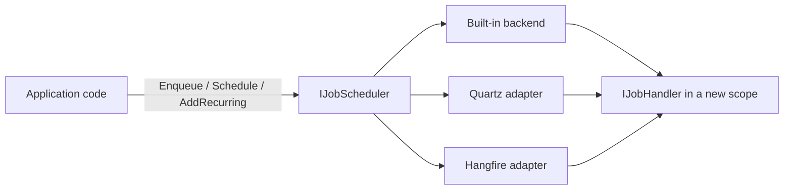

# Regira System — Scheduling

Run a job **now** in the background, **once at a time**, or **on a cron schedule**. A job is a class resolved from the container, with an optional input. It is written against a small contract, and the scheduler that runs it is one registration: the built-in one, [Quartz.NET](https://www.quartz-scheduler.net/) or [Hangfire](https://www.hangfire.io/).

| Layer | Package | What it holds |
|-------|---------|---------------|
| The contract | `Regira.System` | `IJobHandler`, `IJobHandler<TInput>`, `IJobScheduler`, `CronSchedule` and the options. No dependencies, so a class library that holds job classes references nothing else |
| The built-in backend | `Regira.System.Hosting` | `AddScheduling(...)`: in process and in memory, for development, tests and a single-node application |
| The adapters | `Regira.System.Scheduling.Quartz`, `Regira.System.Scheduling.Hangfire` | `UseQuartz()` / `UseHangfire()`: the same jobs on a Quartz or Hangfire installation the application configures itself |



> **The built-in backend keeps everything in memory.** A job that was accepted is lost on a restart, a job offered after the host stopped is refused with `InvalidOperationException`, a failed run is logged and not retried, and a recurring job runs on every node that hosts the application. When that is not enough, register an adapter: the jobs stay as they are.

---

## A job

```csharp
using Regira.System.Scheduling.Abstractions;

public interface ICartStore
{
    Task ExpireOlderThan(TimeSpan age, CancellationToken token);
    Task Expire(int cartId, CancellationToken token);
}

// without input
public class ExpireStaleCarts(ICartStore carts) : IJobHandler
{
    public Task Execute(JobContext context, CancellationToken token)
        => carts.ExpireOlderThan(TimeSpan.FromHours(2), token);
}

// with input: a small value, never an entity
public record ExpireCartInput(int CartId);
public class ExpireCart(ICartStore carts) : IJobHandler<ExpireCartInput>
{
    public Task Execute(ExpireCartInput input, JobContext context, CancellationToken token)
        => carts.Expire(input.CartId, token);
}
```

`JobContext` tells a run about itself: `JobId` (the id `Enqueue` or `Schedule` returned; a new one for every recurring run), `RecurringId` (`null` for a one-off job) and `ScheduledAt` (the time the run was due, when the backend knows it; on Hangfire a recurring run carries the time Hangfire created it, up to its polling interval later).

### The portable contract

A handler written to these rules runs unchanged on all three backends.

1. **A job is a class**, resolved from a new scope for every run, so it may inject a `DbContext`. A handler that is not registered in the container is created with the scope's services.
2. **The input is a small JSON-serializable value**: an id or a few plain properties, not an entity graph. A persistent backend stores it, and another node may read it. The built-in backend serializes it as well, so an input that cannot be stored is refused in development and not on the first deployment with an adapter.
3. **A run may happen more than once.** A retry, a recovery after a crash or a second node can repeat it. Write the handler so that repeating it is safe.
4. **A schedule is a cron expression in an explicit time zone**, UTC unless set, in the [subset](#cron-expressions) every backend reads the same way.
5. **A recurring job does not overlap itself** unless the application asks for that with `AllowConcurrent`.
6. **A missed occurrence runs once** when the scheduler is back, or is skipped. It is never replayed occurrence by occurrence.
7. **Cancellation is cooperative.** The token is signalled on shutdown and by `Cancel(jobId)`.

What the contract leaves to the backend: whether a failed run is retried, whether a job survives a restart, how many nodes run it, and what a dashboard shows. The [backend table](#backends) states each.

---

## Registration

<!-- no-compile -->
```csharp
using Regira.System.Hosting.Scheduling.DependencyInjection;

builder.Services.AddScheduling(s =>
{
    s.AddRecurring<ExpireStaleCarts>("expire-stale-carts", "*/15 * * * *");
    s.AddRecurring<SendDailyReport>("daily-report", "0 7 * * MON-FRI",
        o => o.TimeZone = TimeZoneInfo.FindSystemTimeZoneById("Europe/Brussels"));
    s.AddRecurring<ExpireCart, ExpireCartInput>("expire-demo-cart", new ExpireCartInput(1), "0 3 * * *");
});
```

- `AddScheduling` registers `IJobScheduler` and the built-in backend.
- `AddRecurring` registers its handler as scoped and declares a schedule. The declarations are applied when the host starts, on whichever backend is registered, so a persistent backend ends up with the declared schedule after every deployment. A recurring job that is no longer declared stays in a persistent store until `RemoveRecurring(id)` is called.
- A recurring job is identified by a string id the application chooses. Declaring an id twice throws `ArgumentException`; an expression outside the subset throws `FormatException`. Both happen at registration.
- A time zone id needs the machine's time-zone data. A container image without it (`tzdata`) knows only UTC.

| `RecurringJobOptions` | Default | Meaning |
|-----------------------|---------|---------|
| `TimeZone` | `TimeZoneInfo.Utc` | The zone the cron expression is read in, daylight-saving changes included |
| `Misfire` | `MisfirePolicy.RunOnce` | What happens to occurrences that were missed: one run, or none with `MisfirePolicy.Skip` |
| `AllowConcurrent` | `false` | When `false`, a run never overlaps the previous run of the same job |

Two settings belong to the built-in backend alone: `s.InMemory.MaxConcurrency` (default: the processor count) caps how many runs execute at once, and `s.InMemory.MisfireThreshold` (default one minute) is how late an occurrence may start before it counts as missed.

---

## Enqueue, schedule and cancel

Inject `IJobScheduler` wherever a job has to start.

<!-- no-compile -->
```csharp
app.MapPost("/carts/{id:int}/expire", async (int id, IJobScheduler jobs) =>
{
    var jobId = await jobs.Enqueue<ExpireCart, ExpireCartInput>(new ExpireCartInput(id));
    return Results.Accepted(value: new { jobId });
});
```

| Member | Does |
|--------|------|
| `Enqueue<TJob>()`, `Enqueue<TJob, TInput>(input)` | Runs the job as soon as possible and returns its id |
| `Schedule<TJob, TInput>(input, at)` | Runs it once, at the given time, and returns its id |
| `Cancel(jobId)` | Cancels a job that waits, or signals the token of one that runs: also a recurring run, by the `JobId` of its context. `false` for a job that already ran or does not exist |
| `AddOrUpdateRecurring<TJob>(id, schedule, options?)`, `AddOrUpdateRecurring<TJob, TInput>(id, input, schedule, options?)` | Adds a recurring job, or replaces the one with the same id |
| `RemoveRecurring(id)` | Removes a recurring job. `false` when no recurring job has the id |
| `Trigger(id)` | Runs a recurring job now, outside its schedule. `false` when no recurring job has the id |

A job id identifies a job and grants nothing: Hangfire's are sequential numbers. An endpoint that cancels by an id a client sends checks first that the job is that caller's.

There is no status, history or progress query. Quartz and Hangfire each have a dashboard for that, and progress a caller polls is what the [background task queue](hosting.md#background-task-queue) does. The queue runs a closure in this process; scheduling runs a named job class that may run later, on a schedule, after a restart or on another node. Both can be registered side by side.

---

## Cron expressions

`CronSchedule` holds an expression of the portable subset. A string converts to one implicitly, and `CronSchedule.Parse` throws `FormatException` for anything outside the subset, so an expression fails the same way on every backend, at registration.

- Five fields: minute, hour, day of month, month, day of week. A sixth, leading field is seconds.
- Values, `*`, lists (`1,15`), ranges (`MON-FRI`), steps (`*/15`, `9-17/2`), and month and weekday names.
- Day of week is 0 to 6 with Sunday as 0; 7 is also Sunday.
- A value with a step runs to the end of its field: `5/20` in minutes is 5, 25 and 45. In day of week the field ends at 7, so `1/2` is Monday, Wednesday, Friday and Sunday.
- A number is one or two digits, without a sign.
- At most one of day-of-month and day-of-week is restricted. Cron dialects disagree on whether both means either or both.
- Not in the subset: `?`, `L`, `W`, `#`, year fields, macros such as `@daily`, and a range that runs backwards (`FRI-MON`; write `FRI-SAT,SUN-MON`).

| Expression | Fires |
|------------|-------|
| `*/15 * * * *` | Every 15 minutes |
| `0 7 * * MON-FRI` | At 07:00 on weekdays |
| `0 0 1,15 * *` | At midnight on the 1st and the 15th |
| `*/10 * * * * *` | Every 10 seconds |

---

## Backends

| | Built-in | Quartz adapter | Hangfire adapter |
|---|---|---|---|
| Storage | None, in memory | The job store the application gives Quartz | The storage the application gives Hangfire |
| Survives a restart | No | With a persistent job store | Yes |
| Several nodes | Every node runs every recurring job | Clustered on a database job store | Any server takes any job |
| A run that throws | Logged, not retried | Not retried unless the application configures Quartz to | Retried, 10 times by default |
| Overlap of a recurring job | The occurrence is skipped; a triggered run waits | The run is held until the previous one ends | The run is skipped |
| Time precision | The clock | The clock | Whole seconds, polled every 15 seconds by default (`SchedulePollingInterval`) |
| Dashboard | None | Quartz's own | Hangfire's own |
| Targets | `net8.0`, `net10.0` | `net10.0` (Quartz 4) | `net8.0`, `net10.0` |
| Licence of the dependency | MIT (Cronos) | Apache-2.0 | LGPL-3.0 or commercial (Hangfire.Core) |

An adapter replaces the backend and nothing else. The application configures Quartz or Hangfire itself: its store, its clustering, its dashboard. What only one of them does stays reachable through that library's own API, beside the contract.

### Quartz

<!-- no-compile -->
```csharp
using Quartz;
using Regira.System.Scheduling.Quartz;

builder.Services.AddQuartz(q => q.UsePersistentStore(/* the application's own Quartz setup */));
builder.Services.AddQuartzHostedService();
builder.Services.AddScheduling(s => { /* as above */ }).UseQuartz();
```

- Built on Quartz 4, which targets `net10.0` and later. A `net8.0` application uses the built-in backend or the Hangfire adapter.
- A recurring job is a durable job with one cron trigger, both named by the job's id in group `regira.recurring`. A one-off job is a trigger in group `regira.jobs`, named by the id `Enqueue` or `Schedule` returned.
- The cron expression is translated to the Quartz dialect (`QuartzCron.Translate`): a leading `0` for seconds when there are five fields, `?` in the day field that is not restricted, months as numbers, and weekdays as Quartz numbers them. The trigger always carries the option's time zone.
- `AllowConcurrent = false` is Quartz's own rule against concurrent execution, per recurring job.

### Hangfire

<!-- no-compile -->
```csharp
using Hangfire;
using Regira.System.Scheduling.Hangfire;

builder.Services.AddHangfire(c => c.UseSqlServerStorage(connectionString));   // the application's own Hangfire setup
builder.Services.AddHangfireServer();
builder.Services.AddScheduling(s => { /* as above */ }).UseHangfire();
```

- The package references `Hangfire.Core` only. The application adds `Hangfire.AspNetCore` or `Hangfire.NetCore` and a storage package.
- Hangfire's retry filter applies as the application configured it. With Hangfire's default, a handler that throws runs again up to ten times: rule 3 is not optional on this backend.
- `AllowConcurrent = false` takes a distributed lock per recurring job for the length of the run. A run that finds it taken is skipped.
- `JobContext.ScheduledAt` of a recurring run is the time Hangfire's poll created the run, not the cron occurrence: up to `SchedulePollingInterval` (15 seconds by default) later. A job that needs the occurrence rounds it down itself.
- `Cancel` reaches the jobs this scheduler stored and no others: it returns `false` for a job the application gave Hangfire itself. Recurring ids are Hangfire's own, so a recurring job declared here and one the application registers with `RecurringJob.AddOrUpdate` under the same id are one job.
- The input is serialized with Newtonsoft.Json, where Quartz and the built-in backend use `System.Text.Json`. An input of plain properties reads the same in all three.
- Hangfire.Core is LGPL-3.0 (or commercially licensed). Some policies refuse LGPL dependencies outright; it is this adapter's dependency alone.

### Stored type names

A persistent backend stores the handler's and the input's full type names with every job. Renaming or moving either breaks the jobs already stored: let them drain before such a change, or re-register the recurring ones. The declared ones are re-registered at every start.

### Another scheduler

The contract is public, so one more backend is one more `IJobScheduler`, registered with `AddScheduling(...).UseScheduler<TScheduler>()`. It runs a handler from the scope of its run with `JobHandlerInvoker.Run<TJob>(scopedServices, context, token)` or `JobHandlerInvoker.Run<TJob, TInput>(scopedServices, input, context, token)`. `CronSchedule.GetDaysOfWeek()` gives the days an expression fires on, for a backend that numbers or names them differently, as Quartz does.

---

## Overview

1. [Index](../README.md) — Overview, projects, and installation
1. [Process Execution](processes.md) — Running commands and executables, capturing their output
1. [Hosting](hosting.md) — `WebHostOptions`, background task queues, Windows Service installer
1. **[Scheduling](scheduling.md)** — Jobs that run now, later or on a cron schedule, on the built-in backend, Quartz or Hangfire
1. [Project Files](projects.md) — Parsing and managing `.csproj` files

## License

Apache License 2.0 — this package contains no license validation and no runtime limits. See [LICENSE](https://github.com/Regira/Regira-Packages/blob/main/LICENSE). A few companion packages are commercially licensed with a free tier; see the [licensing overview](https://regira.github.io/Regira-Packages/licensing.html).
